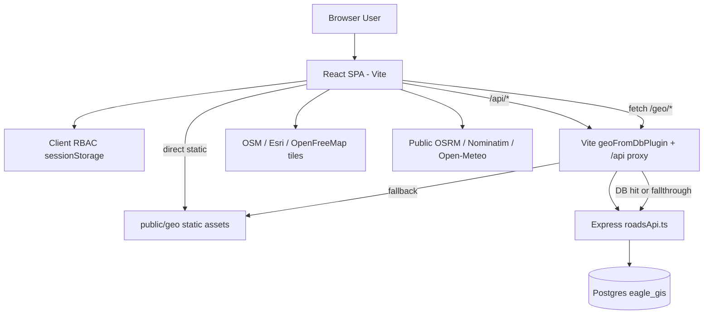
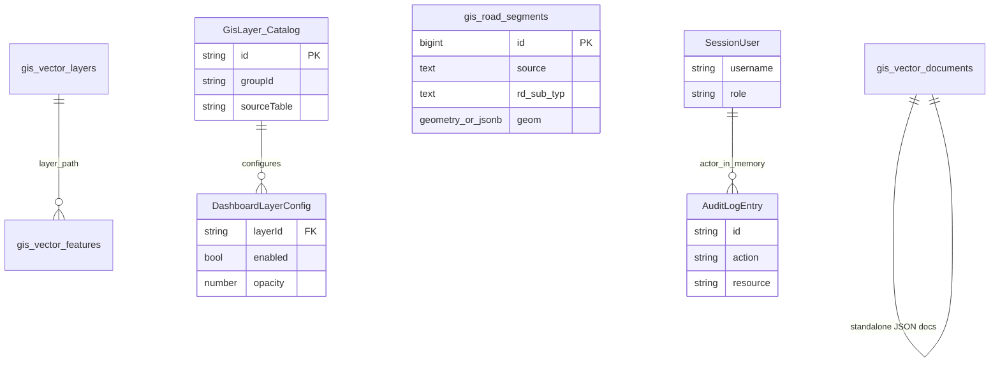
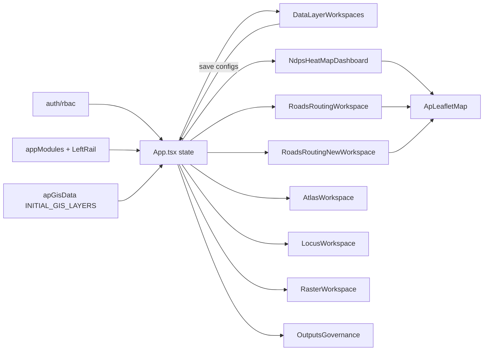

# AP-Eagle-GIS — Complete Application Analysis, Functional Audit & Technical Architecture Assessment

| Field | Value |
|---|---|
| Application root | `/home/ashish-ratna/AP-Eagle-GIS` |
| Report filename | `AP-Eagle-GIS-application-analysis.md` |
| Audit date | 2026-11-17 |
| Audit type | Read-only code and repository inspection |
| Source modifications | **None** — inspection and documentation only |
| Runtime PostGIS / Roads API | **Unreachable** at audit time (`http://127.0.0.1:8787/api/health`) |
| Unit test execution | **Not run** — `node_modules` / Vitest absent in this environment |
| E2E execution | **Not run** — Playwright not executed during this audit |

**Evidence classification used throughout:** Verified (code/path confirmed) · Inference (reasonable from code structure) · Unverified (needs runtime) · Unknown.

---

## 1. Executive Summary

**AP-Eagle-GIS** (product metadata: *EAGLE Force AP | GIS Monitoring & Spatial Intelligence*) is a browser-based geospatial intelligence SPA for Andhra Pradesh law-enforcement / EAGLE Force spatial operations. It lets operators explore administrative and operational GIS layers, compose maps, run road-network routing and corridor analysis, produce Atlas map products, export Locus KMZ packages for field use, and view raster/topo overlays.

**Who uses it (as implemented):** four demo RBAC roles — State Spatial Admin, Field Commander (Eagle), District Nodal (ASR), and Analyst Viewer — authenticated with hardcoded client-side credentials stored in `sessionStorage`. There is no production identity provider.

**Main problem it solves:** consolidating AP administrative boundaries, OPS crime/enforcement layers (hotspots, drug routes, check posts, seizures, etc.), road networks, and field map products into one interactive workspace with role-filtered navigation.

**Major capabilities (verified in code):**
- Situation dashboard with Leaflet map, India → AP → district → mandal → village drill, and layer visibility driven by catalog saves.
- Layer catalogs (Administrative / Operational / Road Network) that save selections to Dashboard, Roads Routing, and Roads Routing New.
- Client-side network routing on saved road GeoJSON, with optional public OSRM fallback.
- POI/corridor “Roads Routing New” product.
- Atlas (district composition + PNG/PDF-style export), Locus KMZ export, Raster/SOI topo overlays.
- Optional Postgres/PostGIS roads + vector catalog API for large road networks and DB-backed `/geo` serving.
- Client-only audit log of session actions; demo seizure report table with CSV export.

**Major workflows:** Login → navigate RBAC-filtered modules → toggle/save layers → view on Dashboard or routing modules → export Atlas/Locus products.

**Key integrations:** Static GeoJSON under `public/geo/`; optional local Express roads API; OSM/Esri/OpenFreeMap basemap tiles; public OSRM, Nominatim, Open-Meteo (browser). **Gemini / `@google/genai` is declared but unused.**

**Stack:** React 19 + TypeScript + Vite 8 + Tailwind 4 + Leaflet / MapLibre; Express + `pg` optional backend; PostGIS optional; Python offline conversion scripts.

**Data architecture:** Primarily file-based GIS assets. Optional Postgres tables `gis_road_segments`, `gis_vector_layers`, `gis_vector_features`, `gis_vector_documents`. App operational state (layers, audit, ingest, digitize) is mostly in-memory / browser storage — **not a transactional business database**.

**Maturity:** Core GIS map, catalogs, routing, Atlas/Locus/Raster are substantially implemented. NDPS Analytics is an explicit demo dummy. Governance reports/audit are partial. Advanced Map Viewer / ingest / digitize UI exists largely as an **orphaned** `MapViewerWorkspace` (~2.4k lines) not mounted in current nav. Auth is demo-grade. No Docker/CI. Roads API was not runtime-verified in this audit.

**Major gaps / risks:** Client-only RBAC (APIs unauthenticated); plaintext demo passwords; unused Gemini packaging; orphan Map Viewer / digitize / import path; demo NDPS and seizure data; layer persistence cleared on every full page load; no durable user/audit store; production deploy story incomplete (proxy + DB + static assets).

---

## 2. Application Overview

### What is this application?

A single-page **geospatial monitoring and spatial product** application for Andhra Pradesh EAGLE Force / NDPS-oriented operations. Metadata (`metadata.json`) describes it as an enterprise geospatial intelligence and tactical cartographic platform. README still reflects Google AI Studio packaging.

### Why was it developed?

To give operators a unified AP GIS shell for:
1. Situational awareness on administrative and OPS layers.
2. Road network exploration and routing/corridor analysis.
3. Field products (Atlas maps, Locus KMZ, raster/topo).
4. Lightweight governance (audit trail UI, seizure report samples).

Architecture-export notes (`architecture-export/paragraphs.txt`) also mention conceptual CCTV/ANPR and advanced analysis as planning topics — **not verified as live integrations** in this codebase.

### Who uses it?

| Role ID | Display (demo) | Intended responsibility (from RBAC matrix) |
|---|---|---|
| `STATE_SPATIAL_ADMIN` | Administrator | Full module access; all permissions |
| `FIELD_COMMANDER_EAGLE` | Eagle operator | Ops/field focus; no admin layers, NDPS analytics, or users/audit |
| `DISTRICT_NODAL_ASR` | District operator | District GIS + products; no NDPS analytics / users-audit |
| `ANALYST_VIEWER` | Viewer | Dashboard, reports, Atlas only; no mutate permissions |

### What problems does it solve?

- Fragmented GIS files (admin, OPS, roads, raster) → browsable layer catalogs and map composition.
- Need for district-scoped field packages → Locus KMZ / Atlas export.
- Large road networks unsuitable as single browser GeoJSON → optional PostGIS bbox/MVT API.
- Role-based visibility of sensitive modules (client-enforced demo).

### What can users actually accomplish?

**Verified as implemented in UI (code):** map exploration with admin drill; layer toggle/save; routing on saved networks; POI corridor display; Atlas/Locus/Raster workflows; CSV/JSON client exports; demo login.

**Demo / partial:** NDPS Analytics charts; seizure analytics table; in-session audit log.

**Not available in current nav despite code:** full Map Viewer dock (search, attribute table, ingest panel, 3D MapLibre tools, digitize UX).

### Primary workflows

1. Authenticate with demo user → open Dashboard.
2. Catalog → select Visible layers → Save to Dashboard / Roads Routing / Roads Routing New.
3. Dashboard map shows saved layer composition + admin hierarchy drill.
4. Roads Routing: place points → compute routes on saved road layers (± OSRM).
5. Atlas/Locus/Raster: pick district → select layers → display → export.
6. Admin: view Users & Audit Trail table → export JSON.

### Systems it depends on

| Dependency | Required? | Notes |
|---|---|---|
| Static `public/geo/**` | **Yes** for core maps | 53 GeoJSON + rasters (JPGs) etc. |
| Browser | **Yes** | SPA only |
| Postgres / PostGIS | Optional | Full roads + DB catalog |
| Express roads API (`server:roads`) | Optional | `/api/gis-roads/*`, catalog `/geo` from DB |
| Public OSM/Esri/OpenFreeMap tiles | Yes for basemaps | External |
| OSRM / Nominatim / Open-Meteo | Optional | Routing fallback / search / elevation |
| Gemini API | **Not used** | Declared only |

### Major functional limitations

- No real user directory, password hashing, or server sessions.
- No durable case/FIR/offender database — OPS layers are static GeoJSON; NDPS Analytics is dummy.
- Digitize/import not reachable from current module nav.
- Full AP roads (~153k) blocked as untiled GeoJSON by design; needs PostGIS.
- No Docker/CI/CD in repo; production packaging incomplete.
- Gemini capability advertised but not implemented.

---

## 3. Architecture & Technology Overview

### High-level architecture



### Technology inventory

| Technology | Where used | Active? |
|---|---|---|
| React 19 / react-dom | SPA UI | Yes |
| TypeScript | `src/`, `server/` | Yes |
| Vite 8 | Dev/build | Yes |
| Tailwind CSS 4 | Styling | Yes |
| Leaflet + react-leaflet | Primary 2D map | Yes |
| MapLibre GL + leaflet bridge | 3D / basemap / MVT | Yes (partial modules) |
| Express | Roads + catalog API | Optional runtime |
| `pg` | Postgres access | Optional |
| PostGIS | Roads MVT + geometry | Optional |
| `shapefile` | `db:load-roads` | Seed scripts |
| `sql.js` | Browser GPKG ingest | Ingest path (orphaned UI) |
| `geotiff` / `proj4` / `jszip` | Raster/CRS/KMZ | Yes in product modules |
| `html2canvas` / `modern-screenshot` | Atlas capture | Yes |
| `@google/genai` | Declared in `package.json` | **Unused** |
| Vitest / Playwright | Tests | Present as source; not executed here |
| Python scripts | Offline GIS conversion | Dev/ops tooling, not runtime |

### Deployment assumptions

- `npm run dev` serves SPA on port 3000.
- Optional `npm run server:roads` on `ROADS_API_PORT` (default 8787).
- No Dockerfile, docker-compose, or `.github` workflows found.
- AI Studio metadata expects Cloud Run / secrets injection for Gemini — **not wired in app code**.

---

## 4. Repository Structure & Codebase Inventory

```text
AP-Eagle-GIS/
├── index.html, package.json, vite.config.ts, tsconfig.json, vitest.config.ts
├── playwright.config.ts, e2e/acceptance.spec.ts
├── .env.example                 # Gemini + Postgres/roads vars (names only)
├── metadata.json                # Product name + Gemini capability flag
├── README.md                    # AI Studio run instructions
├── architecture-export/         # Planning paragraphs (not runtime)
├── public/
│   ├── geo/                     # Primary GIS assets (~306 files)
│   │   ├── *.geojson            # AP state/districts/highways/etc.
│   │   ├── gis-source/{admin,ops,roads,raster}/
│   │   ├── atlas/, villages/
│   ├── ndps/                    # Demo offender photo
│   └── assets/
├── src/                         # Frontend (~166 TS/TSX files)
│   ├── main.tsx, App.tsx
│   ├── auth/                    # Demo RBAC
│   ├── nav/appModules.ts        # M1–M4 navigation
│   ├── components/              # Shell + workspaces + gis/
│   ├── data/                    # Layer catalog + dummy analytics
│   ├── gis/                     # Catalogs, hooks, atlas/locus/raster/ingest/routing
│   ├── types/, utils/
├── server/
│   ├── roads/                   # Express API, DB, road loader
│   └── gis-catalog/             # Vector catalog schema/seed/serve/Vite plugin
└── scripts/                     # Python GIS inspect/convert tools
```

| Area | Approx. scale | Notes |
|---|---|---|
| `src/**/*.ts(x)` | ~166 files | Includes ~45 unit test files |
| `ApLeafletMap.tsx` | ~3907 lines | Central map engine |
| `MapViewerWorkspace.tsx` | ~2395 lines | **Not imported by App** |
| `App.tsx` | ~765 lines | Shell + state |
| `server/` | 10 files | Single Express process |
| `public/geo` | 53 geojson, 243 jpg, 5 json, 5 png | File-backed GIS |

**Monorepo?** No — single npm package (`react-example` in `package.json`) with colocated optional Node API.

**Independently deployable services:** SPA build + optional `server:roads` process.

---

## 5. Module Inventory

Navigation source: `src/nav/appModules.ts`. Workspace rendering: `src/App.tsx`.

### M1 — Situation Awareness

| Module | UI | Purpose | Primary users | Status |
|---|---|---|---|---|
| Dashboard (`ndps-spatial-dashboard`) | `CoreOpsWorkspaces` → `NdpsHeatMapDashboard` + `ApLeafletMap` | Operational map + admin drill + saved layers | All roles | **Implemented** (map); alerts/jobs empty |
| NDPS Analytics (`ndps-analytics`) | `NdpsAnalyticsWorkspace` | Hotspot/offender analytics panels | Admin only | **Placeholder** (dummy data) |
| Reports & Seizure Analytics | `OutputsGovernanceWorkspaces` | Seizure summary table + CSV | Admin, Eagle, ASR, Viewer | **Partial** (demo rows) |

### M2 — Layers & Data

| Module | UI | Purpose | Status |
|---|---|---|---|
| Administrative Layers | `DataLayerWorkspaces` | Catalog of admin layers; save destinations | **Implemented** |
| Operational (OPS) Layers | same | OPS layer catalog | **Implemented** |
| Road Network Layers | same | Transport/road catalog | **Implemented** |
| Roads Routing | `RoadsRoutingWorkspace` | Multi-point routing on saved networks | **Implemented** |
| Roads Routing New | `RoadsRoutingNewWorkspace` | POI corridor / association product | **Implemented** |

### M3 — Products & Field

| Module | UI | Purpose | Status |
|---|---|---|---|
| Atlas | `AtlasWorkspace` + `src/gis/atlas/*` | District map composition & export | **Implemented** |
| Locus | `LocusWorkspace` + `src/gis/locus/*` | Field KMZ export | **Implemented** |
| Raster | `RasterWorkspace` + `src/gis/raster/*` | SOI topo / raster overlays | **Implemented** |

### M4 — System & Governance

| Module | UI | Purpose | Status |
|---|---|---|---|
| Users & Audit Trail | `OutputsGovernanceWorkspaces` | Session audit table + JSON export | **Partial** — no user management UI despite `manageUsers` |

### Supporting / orphan modules

| Module | Location | Status |
|---|---|---|
| Map Viewer (legacy shell) | `src/components/MapViewerWorkspace.tsx` | **Unused** in nav — rich UI orphaned |
| Ingest Panel | `src/components/gis/IngestPanel.tsx` | Used by Map Viewer path; not current nav |
| Login | `LoginScreen.tsx` | **Implemented** (demo) |
| Left rail / Top header | `LeftNavigationRail.tsx`, `TopCommandHeader.tsx` | **Implemented** |

### Shared GIS subsystems

| Subsystem | Path | Role |
|---|---|---|
| Layer catalog seed | `src/data/apGisData.ts` | 39 layers across admin/ops/transport/raster |
| GIS-Source catalog | `src/gis/gisSourceCatalog.ts` | URLs under `/geo/gis-source/...` |
| Admin safety gates | `src/gis/adminGisSourceSafety.ts` | Blocks unsafe primary-layer replacement |
| Dashboard/routing configs | `dashboardLayers.ts`, `roadsRoutingLayers.ts`, `roadsRoutingNewLayers.ts` | Persist selection configs |
| Boundary/network hooks | `useApBoundaries`, `useApAdmin`, `useApNetwork`, `useGisSource*` | Load `/geo` and optional API |
| Ingest pipeline | `src/gis/ingest/*` | Browser file/service ingest |
| Offline converters | `scripts/*.py` | SHP/KMZ → public geo assets |

---

## 6. Feature Inventory

| Feature | Module | Implementation notes | Status |
|---|---|---|---|
| Demo login / logout | Auth | Hardcoded users; sessionStorage | Implemented |
| RBAC nav filtering | Auth + rail | Workspace allow-lists | Implemented (client-only) |
| Admin hierarchy drill | Dashboard | India/AP/district/mandal/village | Implemented |
| Layer visibility catalog | M2 catalogs | Visible checkboxes + filters | Implemented |
| Save layers to Dashboard | Catalogs → App handlers | Updates `dashboardLayerConfig` | Implemented |
| Save layers to Roads Routing / New | Catalogs | Separate configs | Implemented |
| Dashboard map composition | Dashboard | Uses saved dashboard layers | Implemented |
| Multi-point road routing | Roads Routing | Client graph + optional OSRM | Implemented |
| Travel modes | Roads Routing | `roadsRoutingTravelMode.ts` | Implemented |
| POI corridor analysis | Roads Routing New | Associate features with POIs | Implemented |
| PostGIS NH/full roads | Map / routing | `/api/gis-roads/geojson`, MVT | Unverified runtime (API down) |
| Atlas compose/export | Atlas | Dom capture + decorations | Implemented |
| Locus KMZ download | Locus | JSZip; gated by `export` | Implemented |
| Raster SOI overlays | Raster | Manifest + JPG ground overlays | Implemented |
| Seizure report CSV | Reports | Static seed rows | Partial |
| Audit log view/export | Users & Audit | In-memory + seeds | Partial |
| NDPS offender analytics | NDPS Analytics | `ndpsAnalyticsDummy.ts` | Placeholder |
| Feature digitize | App state | Handlers exist; catalog ignores props | Partial / Placeholder UI |
| File/service ingest | Ingest | Full pipeline; nav-orphaned | Unused in current nav |
| 3D MapLibre viewer | ApMapLibre3DMap | Present; primarily Map Viewer era | Unused in current nav |
| Tactical alerts | Header | `INITIAL_TACTICAL_ALERTS` empty | Unused / empty |
| GIS jobs queue | Types/data | `INITIAL_GIS_JOBS` empty | Unused |
| Gemini AI analysis | Declared | No call sites | Unused |
| User administration | Permission only | No UI | Unused |
| APSAC GeoServer / Overpass | `gisSources.ts` | Marked `not connected` | Unused |

---

## 7. Important Button & User Action Audit

Status key: Implemented · Partial · Unverified · Unused · Placeholder · Broken.

### Authentication

| User action | Expectation | Actual trace | Status |
|---|---|---|---|
| Submit login | Authenticate and open shell | `LoginScreen` → `AuthContext.login` → `authenticate()` in `rbac.ts` → `sessionStorage` `eagle_gis_session` → render `AppShell` | Implemented |
| Invalid login | Error | Sets login error testid; no API | Implemented |
| Logout | Clear session | Removes session key; returns to login | Implemented |

### Navigation

| User action | Trace | Status |
|---|---|---|
| Select nav item | `LeftNavigationRail` → `handleSelectWorkspace` → `canOpen` → `setActiveWorkspace` | Implemented |
| Denied workspace | Toast “Access denied…” | Implemented |
| Brand → Dashboard | Top header switch workspace | Implemented |
| Fullscreen map | `mapFullscreen` + `requestFullscreen` on several map modules | Implemented |

### Catalog / layers

| User action | Trace | Status |
|---|---|---|
| Toggle Visible | `DataLayerWorkspaces` → `onToggleLayer` → `App.handleToggleLayer` → layers state | Implemented |
| Save to Dashboard | `handleSaveDashboardLayers` → `persistDashboardLayerConfig` + audit append | Implemented |
| Save to Roads Routing / New | Analogous handlers + persist | Implemented |
| Remove saved via hover menu | Exclusion + config delete | Implemented |
| Open Dashboard after save | `onSwitchWorkspace('ndps-spatial-dashboard')` | Implemented |

**Note:** `main.tsx` calls `clearPersistedLayerSelections()` on every load — localStorage layer picks do **not** survive hard refresh. Persistence is intra-session only until reload.

### Dashboard map

| User action | Trace | Status |
|---|---|---|
| Drill India/AP/district… | `AdminDrillBar` + `ApLeafletMap` admin hierarchy | Implemented |
| View layer geometries | Hooks fetch `/geo/...` or `/api/gis-roads/...` based on layer | Implemented / Unverified for PostGIS |
| Fly to search target | App handlers + `searchTargets`; rich search UI mainly in orphan Map Viewer | Partial in current shell |

### Roads Routing

| User action | Trace | Status |
|---|---|---|
| Add route points | Workspace state / map click | Implemented |
| Calculate routes | `roadsRoutingGraph` on loaded GeoJSON; optional `osmServices` OSRM | Implemented |
| Toggle OSM fallback | Client flag + OSRM fetch | Implemented |
| Manage saved layer visibility | Config mutators from App | Implemented |

### Roads Routing New

| User action | Trace | Status |
|---|---|---|
| Add POIs / display networks | Fetches layer URLs including `/api/gis-roads/geojson?layer=nh|full` | Implemented (API optional) |
| Clear saved | Clears config + hover exclusions | Implemented |

### Atlas / Locus / Raster

| User action | Trace | Status |
|---|---|---|
| Select district & layers | Module config + inventory | Implemented |
| Display composition | Map flags + GeoJSON loads | Implemented |
| Atlas export image | `atlasExport` / `captureDomCanvas` | Implemented; **not** gated by `can('export')` |
| Locus KMZ | `downloadLocusKmz` + fetch layer GeoJSON; `can('export')` | Implemented |
| Raster display | `useGisSourceRaster` + overlays | Implemented |

### Governance

| User action | Trace | Status |
|---|---|---|
| Toggle seizure period | Local UI state | Implemented |
| Export seizure CSV | `downloadTextFile` from seed rows | Partial (demo data) |
| Export audit JSON | In-memory `auditLogs` | Partial (not durable) |

### Orphaned Map Viewer actions (code present, not in App nav)

| Action | Handler location | Status |
|---|---|---|
| Search / attribute table / tools | `MapViewerWorkspace.tsx` | Unused |
| Ingest publish | `IngestPanel` → `handlePublishIngested` | Unused in nav |
| Digitize add/delete | App handlers; map supports overlays | Placeholder UI in current modules |

---

## 8. Major Application Workflows

### Workflow A — Layer composition for Dashboard

```text
User opens Administrative/OPS/Road catalog
  → toggles Visible on layers (INITIAL_GIS_LAYERS)
  → clicks Save to Dashboard
  → App.handleSaveDashboardLayers
  → dashboardLayerConfig + localStorage (until next hard refresh)
  → appendAudit
  → Open Dashboard
  → NdpsHeatMapDashboard / ApLeafletMap applies dashboardLayers
  → fetch /geo/... (or DB via middleware) per enabled layer
  → map renders
```

### Workflow B — Roads Routing

```text
User saves road LineString layers to Roads Routing
  → opens roads-routing workspace
  → places waypoints
  → client loads GeoJSON via resolveLayerGeoJsonUrl
  → roadsRoutingGraph finds network routes
  → optional OSRM public API if fallback enabled
  → route geometry displayed on map
```

### Workflow C — Locus field package

```text
User opens Locus → selects district & layers → Display
  → export KMZ (requires export permission)
  → locusExport fetches geometries → JSZip KMZ download
```

### Workflow D — Optional PostGIS full roads

```text
Operator runs db:ensure → db:load-roads → server:roads
  → Vite proxies /api → Express
  → ApLeafletMap / routing New calls /api/gis-roads/geojson or MVT
  → Postgres gis_road_segments queried by bbox
```

**Runtime status this audit:** Roads API unreachable → PostGIS path **Unverified**.

### Workflow E — Login & RBAC

```text
LoginScreen → authenticate(GIS_USERS) → sessionStorage
  → allowedWorkspaces(role) filters rail
  → canOpen blocks unauthorized workspace switches
  → No backend authorization on /api or /geo
```

---

## 9. Backend / API / Service Mapping

**Single backend entry:** `server/roads/roadsApi.ts` (`npm run server:roads`).

**Authentication on APIs:** None.

| Endpoint | Method | Purpose | DB | Callers | Status |
|---|---|---|---|---|---|
| `/api/health` | GET | Roads + catalog health | `gis_road_segments` counts; optional catalog counts | `useRoadsApiMode.ts` | Implemented (code); runtime Unverified |
| `/api/gis-roads/layers` | GET | Static layer metadata | None | **No frontend caller** | Unused |
| `/api/gis-roads/geojson` | GET | Bbox GeoJSON `layer=full\|nh` | SELECT road segments | `gisPostgisRoads.ts`, routing New, map hooks | Implemented (code) |
| `/api/gis-roads/mvt/:layer/:z/:x/:y` | GET | MVT tiles | PostGIS `ST_AsMVT` | `PostgisMvtRoadLayer.tsx` | Implemented when postgis; 501 in bbox mode |
| `/api/gis-catalog/health` | GET | Catalog counts | catalog tables | No frontend caller | Unused |
| `/api/gis-catalog/layers` | GET | List seeded layers | `gis_vector_layers` | No frontend caller | Unused |
| `/api/gis-catalog/geojson?path=` | GET | Load by path | features/documents | No frontend caller | Unused |
| `/geo/*` | GET | Serve FC/doc by path | catalog tables | Frontend `fetch('/geo/...')` via Vite plugin or Express | Implemented (code) |

**Validation:** layer enum, bbox parse, feature limit cap (`ROADS_GEOJSON_FEATURE_LIMIT`).

**GraphQL / WebSocket:** Not identified.

**Seed / load scripts (not HTTP):**

| Script | File | Writes |
|---|---|---|
| `db:ensure` | `server/roads/ensureDb.ts` | Creates DB / PostGIS extension attempt |
| `db:load-roads` | `server/roads/loadGisRoads.ts` | `gis_road_segments` from shapefile |
| `db:seed-geo` | `server/gis-catalog/seedGeojson.ts` | Catalog tables from `public/geo` |
| `reseedRivers.ts` | one-off | Not in package.json |

---

## 10. Database & Storage Inventory

### Relational database (optional)

| Database | Type | Evidence |
|---|---|---|
| `eagle_gis` (default `PGDATABASE`) | PostgreSQL ± PostGIS | `.env.example`, `ensureDb.ts`, `config.ts` |

#### Table: `gis_road_segments`

| Attribute | Details |
|---|---|
| Purpose | Full AP road network segments for bbox GeoJSON / MVT |
| PK | `id` bigserial |
| Important fields | `source` (`ap_full`\|`vsp`), `rd_code`, `rd_type`, `rd_sub_typ`, `shape_leng`, `geom` or `geom_json`+bbox |
| Created by | `loadGisRoads.ts` (only `ap_full` loaded; `vsp` deleted on load) |
| Read by | `roadsApi.ts` |
| Status | Schema Implemented; data load Unverified this environment |

#### Table: `gis_vector_layers`

| Purpose | Catalog index of seeded GeoJSON paths |
| PK | `layer_path` |
| Written by | `seedGeojson.ts` |
| Read by | `serveCatalog.ts` |

#### Table: `gis_vector_features`

| Purpose | Per-feature geometries + properties |
| FK | `layer_path` → `gis_vector_layers` |
| Modes | PostGIS `geom` or JSONB `geom_json` |

#### Table: `gis_vector_documents`

| Purpose | JSON documents (e.g. village index) |
| PK | `doc_path` |

**Migrations:** No Prisma/Flyway — schema ensured at runtime via `CREATE TABLE IF NOT EXISTS`.

### File / object storage

| Store | Purpose | Consumers |
|---|---|---|
| `public/geo/**` | Authoritative browser GIS assets | SPA fetches |
| `public/geo/gis-source/raster/**` | SOI topo JPGs + manifest | Raster module (never DB-seeded) |
| `public/ndps/` | Demo photo | NDPS Analytics |
| Raw `GIS_SOURCE_ROOT` | Offline SHP/KMZ pack | Python scripts + road loader |
| Browser `sessionStorage` | Auth session | AuthContext |
| Browser `localStorage` | Layer configs (cleared on boot) | dashboard/routing/atlas/locus keys |
| In-memory React state | Digitized, ingested, audit, alerts | App.tsx |

### Vector DB / search indexes

Not identified.

---

## 11. Entity Relationship Analysis

There is **no traditional business ER model** (users, cases, FIRs as DB entities). Relationships are GIS feature properties and application-level configs.



**Database-enforced FKs:** `gis_vector_features.layer_path` → `gis_vector_layers`.

**Application-level relationships:** layer IDs in configs; admin hierarchy name matching (`adminHierarchy.ts`, `mandalSpellings.ts`); OPS feature labels; RBAC role → workspace lists (code constants, not DB).

---

## 12. Complete Data Lifecycle & Lineage

### A. Administrative boundaries (primary)

```text
External GIS / DataMeet / processed GeoJSON
  → scripts (fetch/process/convert) → public/geo/ap-districts-2022.geojson, ap-state.geojson, india-*.geojson
  → optional db:seed-geo → gis_vector_*
  → browser fetch /geo/... (DB proxy or static)
  → useApBoundaries / useApAdmin / ApLeafletMap
  → Dashboard drill UI
```

**Authoritative for drill:** post-2014 AP assets (`adminGisSourceSafety.ts` blocks GIS-Source undivided replacements).

### B. OPS enforcement layers

```text
GIS-Source OPS KMZ/SHP
  → scripts/convert-gis-source-ops.py etc.
  → public/geo/gis-source/ops/*.geojson
  → catalog lyr-* entries in apGisData.ts
  → map overlays via useGisSourceOps / ApLeafletMap
```

### C. Road network

```text
GIS-Source ap_roads.shp
  → major subset GeoJSON for browser OR
  → db:load-roads → gis_road_segments
  → /api/gis-roads/geojson|mvt
  → map / routing modules
Fallback NH: /geo/ap-highways.geojson
```

### D. Session audit / seizure reports

```text
Seed arrays in apGisData.ts
  + runtime appendAudit in App
  → React state only
  → governance UI export
  → (no server persistence)
```

### E. NDPS Analytics

```text
Hardcoded ndpsAnalyticsDummy.ts (+ /ndps/offender-photo.png)
  → NdpsAnalyticsWorkspace UI
  → No API / No DB
```

### F. Ingested / digitized features

```text
User file/URL (IngestPanel) or digitize handlers
  → in-memory ingestedLayers / digitizedFeatures
  → ApLeafletMap overlays
  → Lost on refresh; not written to Postgres
```

---

## 13. CRUD & API-to-Database Traceability

| Entity / store | Create | Read | Update | Delete | Modules |
|---|---|---|---|---|---|
| `gis_road_segments` | `db:load-roads` (batch replace by source) | API GeoJSON/MVT/health | Reload script | DELETE by source on reload | Roads API, map, routing |
| `gis_vector_*` | `db:seed-geo` | `/geo/*`, catalog GETs | Reseed | Cascade on layer delete during reseed | Transparent geo serving |
| Layer config (localStorage) | Save buttons | Boot (then cleared) | Toggle/save | Clear/remove | Catalogs, routing |
| Auth session | Login | Boot read | — | Logout | Auth |
| Audit logs | `appendAudit` + seeds | Users & Audit UI | Acknowledge alerts (separate) | Not identified | Governance |
| Digitized / ingested | Handlers | Map overlays | — | Delete digitized handler | Orphaned UI path |
| Seizure report rows | Static seed only | Reports UI | Period filter UI only | Not identified | Reports |
| NDPS dummy | Static | Analytics UI | — | — | NDPS Analytics |

**Soft delete:** Not identified for DB entities. Layer “removal” is config disable/delete, not DB delete.

---

## 14. Background Processing & Asynchronous Workflows

| Process | Trigger | Implementation | Status |
|---|---|---|---|
| DB ensure / load / seed | Manual npm scripts | `tsx` Node scripts | Implemented as CLI |
| Python GIS conversion | Manual | `scripts/*.py` | Offline tooling |
| Cron / queues / workers | — | **Not identified** | N/A |
| Webhooks | — | Not identified | N/A |
| Client toast timers | UI | `setTimeout` in App | Implemented |
| Vite HMR disable | `DISABLE_HMR` | vite.config.ts | Config for AI Studio |

No retry/dead-letter infrastructure for background jobs (none exist as services).

---

## 15. External Integrations

| Integration | Why | Used by | Auth | Failure behavior | Status |
|---|---|---|---|---|---|
| OSM raster tiles | Basemap | `apGeo.ts`, maps | Public | Tile gaps | Implemented |
| OpenFreeMap | Vector/3D basemap | MapLibre components | Public | MapLibre errors | Implemented |
| Esri World tiles | Satellite/topo/street | Basemap presets / Atlas views | Public | Tile gaps | Implemented |
| Mapzen Terrarium DEM | Terrain | 3D map | Public | Unverified depth | Implemented in code |
| OSRM public router | Routing fallback | `osmServices.ts` | None | Route fails / toast | Implemented |
| Nominatim | Geocoding search | `osmServices.ts` | UA courtesy | Empty results | Implemented (mainly Map Viewer) |
| Open-Meteo elevation | Elevation inspect | `osmServices.ts` | None | Unverified | Implemented in code |
| OpenRailwayMap / Waymarked | Overlay presets | `apGeo.ts` | Public | Optional | Configured |
| Postgres | Roads/catalog | server | Password via env | API 503 | Optional |
| Gemini (`@google/genai`) | AI Studio packaging | **No call sites** | API key in env example | N/A | **Unused** |
| APSAC GeoServer / Overpass | Catalog registry | `gisSources.ts` | — | Marked `not connected` | Unused |
| User WMS/WFS/ArcGIS | Ad-hoc ingest | `ingest/webServices.ts` | Operator URL | Fetch errors | Orphaned UI |

---

## 16. Authentication, Authorization & User Roles

### Mechanisms

| Concern | Implementation | Backend enforcement |
|---|---|---|
| Login | Hardcoded `GIS_USERS` passwords in `rbac.ts` | **None** |
| Session | `sessionStorage` JSON (username, role, displayName, unit) — **no password stored in session** | None |
| Workspace ACL | `ROLE_WORKSPACES` + `canOpen` | Frontend only |
| Permissions | `ROLE_PERMISSIONS` + `can()` | Frontend only where checked |
| API ACL | — | **Missing** — all GETs open on localhost bind |

### Role matrix (workspaces)

| Workspace | Admin | Eagle | ASR | Viewer |
|---|:---:|:---:|:---:|:---:|
| Dashboard | ✓ | ✓ | ✓ | ✓ |
| NDPS Analytics | ✓ | | | |
| Reports | ✓ | ✓ | ✓ | ✓ |
| Administrative Layers | ✓ | | ✓ | |
| Operational Layers | ✓ | ✓ | ✓ | |
| Road Network Layers | ✓ | ✓ | ✓ | |
| Roads Routing | ✓ | ✓ | ✓ | |
| Roads Routing New | ✓ | ✓ | ✓ | |
| Atlas | ✓ | ✓ | ✓ | ✓ |
| Locus | ✓ | ✓ | ✓ | |
| Raster | ✓ | ✓ | ✓ | |
| Users & Audit | ✓ | | | |

### Permissions

| Permission | Admin | Eagle | ASR | Viewer | UI enforcement found |
|---|:---:|:---:|:---:|:---:|---|
| digitize | ✓ | ✓ | | | Handlers only — **no current nav UI** |
| import | ✓ | | | | Ingest path / Map Viewer era |
| export | ✓ | ✓ | ✓ | | Locus (+ Map Viewer); Atlas export **not gated** |
| geoprocess | ✓ | ✓ | | | **Unused** in components |
| manageUsers | ✓ | | | | **No UI** |
| viewAudit | ✓ | | | | **Unused** — audit page shown via workspace ACL only |

### Security findings (auth)

- Client RBAC can be bypassed by modifying JS/session — **High** for any sensitive deployment.
- Demo passwords embedded in source and shown on login UI — **High** for production misuse risk.
- Roads/geo APIs unauthenticated — mitigated if bound to `127.0.0.1` only; still **Medium** if exposed.

Evidence: `src/auth/rbac.ts`, `AuthContext.tsx`, `App.tsx`, `server/roads/roadsApi.ts`.

---

## 17. Real-World Business & Functional Use Cases

### UC1 — Situational map for AP operations (Primary)

- **Actor:** Any role with Dashboard access  
- **Objective:** See AP geography with operational overlays  
- **Trigger:** Login → Dashboard  
- **Processing:** Load boundaries + enabled dashboard layers from `/geo`  
- **Outcome:** Interactive Leaflet map with admin drill  

### UC2 — Compose OPS layer set for a briefing (Primary)

- **Actor:** Eagle / ASR / Admin  
- **Objective:** Select hotspots, routes, check posts for Dashboard  
- **Actions:** Operational Layers → Visible → Save to Dashboard → Open Dashboard  
- **Storage:** Client layer config (+ audit memory)  

### UC3 — Plan a road route on GIS network (Primary)

- **Actor:** Eagle / ASR / Admin  
- **Objective:** Multi-point route along agency/GIS roads  
- **APIs:** Local GeoJSON and/or `/api/gis-roads/geojson`; optional OSRM  
- **Outcome:** Route geometry on map  

### UC4 — Produce district Atlas export (Primary)

- **Actor:** Roles with Atlas  
- **Objective:** Export decorated district map product  
- **Tech:** Atlas inventory + DOM capture  

### UC5 — Export Locus KMZ for field devices (Primary)

- **Actor:** Roles with `export`  
- **Objective:** Package selected layers for mobile/field use  
- **Tech:** `locusExport.ts` KMZ download  

### UC6 — View NDPS analytics dashboard (Secondary / Demo)

- **Actor:** Admin  
- **Objective:** Offender/hotspot analytics  
- **Actual:** Static dummy metrics — **not operational data**  

### UC7 — Export seizure summary CSV (Secondary / Demo)

- **Actor:** Roles with Reports  
- **Actual:** Seed “Demo sample” rows  

### UC8 — Review session audit trail (Administrative / Partial)

- **Actor:** Admin  
- **Actual:** Seeded + session `appendAudit` events; JSON export; no server trail  

### UC9 — Import external GIS file (Operational intent / Unused in nav)

- **Code path:** Ingest panel → memory layers  
- **Current product:** Not reachable via `APP_NAV_SECTIONS`  

---

## 18. Module Dependencies & Architecture Diagrams

### Frontend module dependency (simplified)



### Shared coupling notes

- `ApLeafletMap` is the shared map engine for Dashboard and several products.
- Catalog saves feed Dashboard and both routing modules via App-owned configs.
- `MapViewerWorkspace` duplicates a fuller GIS IDE experience but is disconnected — risk of drift vs App state props still prepared for ingest/digitize.
- Atlas/Locus/Raster largely self-contained under `src/gis/{atlas,locus,raster}` with shared map chrome.

### Circular dependencies

No strong package cycles identified; coupling is primarily through `App.tsx` prop drilling.

---

## 19. Feature-to-Implementation Mapping

| Feature | UI | Frontend handler | API/Route | Backend service | Data/Storage | External | Status |
|---|---|---|---|---|---|---|---|
| Login | LoginScreen | AuthContext.login | Not identified | Not identified | sessionStorage | — | Implemented |
| Dashboard map | NdpsHeatMapDashboard | Map hooks | `/geo/*`, `/api/health`, `/api/gis-roads/*` | roadsApi optional | public/geo ± PG | Basemap tiles | Implemented / API Unverified |
| Layer catalog save | DataLayerWorkspaces | App save handlers | Not identified | Not identified | React + localStorage | — | Implemented |
| Roads routing | RoadsRoutingWorkspace | graph + osmServices | `/geo`, optional roads API, OSRM | roadsApi optional | GeoJSON / PG | OSRM | Implemented |
| Roads routing new | RoadsRoutingNewWorkspace | POI association | `/api/gis-roads/geojson`, `/geo` | roadsApi | GeoJSON / PG | — | Implemented |
| Atlas export | AtlasWorkspace | atlasExport | `/geo` fetches | Not identified | Client download | — | Implemented |
| Locus KMZ | LocusWorkspace | locusExport | `/geo` fetches | Not identified | Client KMZ | — | Implemented |
| Raster overlays | RasterWorkspace | useGisSourceRaster | `/geo/gis-source/raster/...` | Not identified (static) | JPG/manifest | — | Implemented |
| NDPS Analytics | NdpsAnalyticsWorkspace | render dummy | Not identified | Not identified | ndpsAnalyticsDummy | — | Placeholder |
| Seizure CSV | OutputsGovernance | downloadTextFile | Not identified | Not identified | INITIAL_SEIZURE_REPORT_ROWS | — | Partial |
| Audit export | OutputsGovernance | JSON download | Not identified | Not identified | auditLogs state | — | Partial |
| Digitize | — (orphaned) | App handlers | Not identified | Not identified | memory | — | Placeholder |
| Ingest | IngestPanel / MapViewer | handlePublishIngested | User URLs | Not identified | memory | WMS/WFS optional | Unused in nav |
| Gemini AI | Not identified | Not identified | Not identified | Not identified | GEMINI_API_KEY unused | Google GenAI pkg unused | Unused |
| User admin | Not identified | Not identified | Not identified | Not identified | GIS_USERS const | — | Unused |

---

## 20. Implementation Status & Verification

| Area | Status | Evidence | Expected | Actual / gap | Impact |
|---|---|---|---|---|---|
| Core Dashboard GIS | Implemented (code); map e2e exists | App, ApLeafletMap, e2e | Live AP map | Code + e2e assertions; full layer runtime not exhaustively verified here | Core product usable when geo assets present |
| Catalog save pipeline | Implemented | DataLayerWorkspaces, App handlers | Persist composition | Works in session; cleared on hard refresh | Operators must re-select after reload |
| Roads Routing | Implemented | RoadsRoutingWorkspace, graph tests | Network routes | Client-side; depends on saved layers | Strong for prepared networks |
| PostGIS roads API | Unverified | roadsApi.ts; curl health failed | Serve full roads | Code present; service down this audit | Full network features may be unavailable |
| Atlas/Locus/Raster | Implemented | Module trees + tests | Field products | Substantial code + unit tests | High maturity |
| NDPS Analytics | Placeholder | ndpsAnalyticsDummy.ts header | Live analytics | Dummy constants | Must not be treated as real intel |
| Reports | Partial | Demo seizure rows | Operational reports | Static samples | Reporting gap |
| Audit / users | Partial / Unused manageUsers | OutputsGovernance, rbac | Durable governance | In-memory audit; no user CRUD | Governance incomplete |
| Map Viewer / ingest | Unused (nav) | No App import of MapViewerWorkspace | Integrated GIS IDE | Orphaned large module | Dead weight / confusion |
| Gemini | Unused | No imports of `@google/genai` | AI capability | Dependency + metadata only | Misleading packaging |
| Client RBAC | Implemented demo | rbac.ts, e2e viewer test | Access control | Frontend only | Not production-safe |
| Background jobs | Not identified | Repo search | Async pipelines | Manual scripts only | Ops are manual |

---

## 21. Gaps, Issues & Unused Functionality

| Finding | Category | Evidence | Severity | Impact | Status | Recommendation |
|---|---|---|---|---|---|---|
| Client-only RBAC; open APIs | Security | AuthContext; roadsApi no auth | Critical (if exposed) | Privilege bypass | Confirmed design | Real IdP + API auth before any shared deploy |
| Hardcoded demo passwords in source/UI | Security | rbac.ts, LoginScreen | High | Credential leak / false production use | Confirmed | Replace with proper auth |
| NDPS Analytics is dummy | Functional | ndpsAnalyticsDummy.ts | High (business) | False operational confidence | Confirmed | Label clearly or wire real data |
| MapViewerWorkspace orphaned | Functional/Technical | No App import | Medium | Digitize/import/search UX unavailable | Confirmed | Reintegrate or archive |
| Digitize/import props unused in catalogs | Functional | DataLayerWorkspaces `_` prefixed props | Medium | Permissions without UX | Confirmed | Wire UI or remove dead state |
| Layer persistence cleared on boot | Functional | main.tsx clearPersistedLayerSelections | Medium | Lost compositions on refresh | Confirmed | Document or make opt-in persist |
| Atlas export not `export`-gated | Security/Functional | AtlasWorkspace vs Locus can('export') | Medium | Viewer can export if given Atlas | Confirmed | Align RBAC checks |
| `geoprocess` / `manageUsers` / `viewAudit` unused | Functional | Permission grep | Low–Medium | Incomplete governance model | Confirmed | Implement or remove |
| Gemini unused but advertised | Technical | package.json, metadata, README | Medium | Stakeholder confusion | Confirmed | Remove or implement |
| Catalog admin API endpoints unused | Technical | serveCatalog vs frontend | Low | Dead surface | Confirmed | Docs or remove |
| `vsp` road source never loaded | Data | loadGisRoads + CHECK constraint | Low | Dead schema branch | Confirmed | Load or drop |
| `reseedRivers.ts` not in npm scripts | Technical | package.json | Informational | One-off drift | Confirmed | Document |
| No Docker/CI | Operational | Missing files | Medium | Deploy inconsistency | Confirmed | Add packaging |
| Seizure/audit not durable | Data | App state only | High for compliance | No forensic trail | Confirmed | Persist if required |
| GIS-Source unsafe as primary admin | Data integrity | adminGisSourceSafety.ts | High if mis-replaced | Wrong geography (Telangana era) | Mitigated in code | Keep safety gates |
| Roads API / Vitest not runtime-verified here | Operational | curl fail; no node_modules | Informational | Audit coverage limit | Environment | Re-verify in provisioned env |

---

## 22. Security, Data Integrity & Operational Risks

### Security

- Demo authentication unsuitable for production.
- No API authorization, rate limiting, or CORS hardening identified.
- Sensitive OPS layer files shipped as static public assets — anyone with app URL can fetch `/geo/...` without login (SPA gate only).
- Do not commit real `PGPASSWORD` / `GEMINI_API_KEY` values (`.env.example` uses placeholders).

### Data integrity

- Explicit safety policy prevents replacing primary 2022 AP districts / post-2014 state / DataMeet India with undivided GIS-Source products.
- Full `ap_roads` must not ship as one browser GeoJSON (payload risk) — API/MVT path preferred.
- Dual storage modes (PostGIS vs JSONB) drop/recreate tables on mismatch — operational risk of data loss on mode flip.

### Operational

- Dual process dependency (Vite + `server:roads`) for full capability.
- `GIS_SOURCE_ROOT` defaults to a Windows path — Linux loaders need env override.
- No monitoring/logging stack identified beyond console/HTTP status codes.
- Preview/production may lack `geoFromDbPlugin` behavior (`configurePreview` not set).

---

## 23. Evidence & Code References

### Frontend

```text
src/main.tsx                          # boot; clears layer persistence
src/App.tsx                           # workspace shell, handlers, state
src/nav/appModules.ts                 # M1–M4 module IDs
src/auth/rbac.ts                      # users, roles, permissions
src/auth/AuthContext.tsx              # sessionStorage session
src/components/LoginScreen.tsx
src/components/LeftNavigationRail.tsx
src/components/TopCommandHeader.tsx
src/components/workspaces/*           # all active workspaces
src/components/MapViewerWorkspace.tsx # orphaned Map Viewer
src/components/gis/ApLeafletMap.tsx   # map engine
src/data/apGisData.ts                 # 39-layer catalog + seeds
src/data/ndpsAnalyticsDummy.ts        # demo analytics
src/gis/adminGisSourceSafety.ts       # replaceAllowed gates
src/gis/gisSourceCatalog.ts
src/gis/dashboardLayers.ts
src/gis/roadsRoutingLayers.ts
src/gis/roadsRoutingNewLayers.ts
src/gis/roadsRoutingGraph.ts
src/gis/osmServices.ts
src/gis/atlas/*, locus/*, raster/*, ingest/*
```

### Backend

```text
server/roads/roadsApi.ts
server/roads/db.ts
server/roads/config.ts
server/roads/ensureDb.ts
server/roads/loadGisRoads.ts
server/gis-catalog/schema.ts
server/gis-catalog/seedGeojson.ts
server/gis-catalog/serveCatalog.ts
server/gis-catalog/viteGeoDbPlugin.ts
```

### Config / infra

```text
package.json, vite.config.ts, .env.example, metadata.json, README.md
playwright.config.ts, e2e/acceptance.spec.ts
scripts/*.py
public/geo/**
```

### Tests (present; not executed in this audit environment)

```text
src/**/*.test.ts (~45 files) — Vitest
e2e/acceptance.spec.ts — 4 Playwright cases (login, admin shell, viewer RBAC, dashboard drill)
```

### Explicit unknowns / limits

- Live PostGIS row counts and MVT tiles: **Evidence insufficient to verify** (API unreachable).
- Vitest suite pass/fail: **Evidence insufficient to verify** (`vitest` absent).
- Completeness of every GeoJSON feature attribute vs OPS ground truth: not independently validated beyond file presence and catalog wiring.
- External tile/OSRM availability from this network: not exhaustively tested.

**No application source files were modified during this audit.** Only this report file was added.

---

## 24. Overall Application Summary

### What the Application Does

AP-Eagle-GIS is a React geospatial SPA that helps Andhra Pradesh EAGLE Force–style operators explore administrative and operational GIS layers, compose maps, analyze road networks/corridors, and export Atlas/Locus/Raster field products. Most “live” geography comes from static GeoJSON (and rasters) under `public/geo`, with an optional Postgres/PostGIS Express service for large road networks and DB-backed vector serving.

### Primary Users

Demo roles: State Spatial Admin, Field Commander (Eagle), District Nodal ASR, and Analyst Viewer. Real organizational IdP users are **not** implemented.

### Major Capabilities

- RBAC-filtered multi-module GIS shell (13 workspaces).
- Layer catalogs with save-to-Dashboard / routing destinations.
- Dashboard map with hierarchical admin drill.
- Two routing products (classic network routing + POI corridor).
- Atlas, Locus KMZ, and Raster/SOI workflows.
- Optional PostGIS roads API (code-complete; runtime not verified here).

### Major Business Use Cases

Situational mapping; OPS layer briefing composition; road route/corridor planning; district Atlas production; field KMZ packaging; lightweight demo reporting/audit review.

### Key Technical Components

React/Vite SPA; Leaflet/MapLibre; Express+pg optional API; file-backed GIS; Python offline ETL scripts; Vitest/Playwright tests in-repo.

### Data Architecture

File-first GIS assets; optional four Postgres tables for roads + vector catalog; ephemeral client state for auth session extras, audit, digitize/ingest; **no** case-management relational schema.

### Implementation Status

| Class | Examples |
|---|---|
| Implemented | Dashboard map, catalogs, routing modules, Atlas/Locus/Raster, demo login/RBAC UI |
| Partial | Seizure reports, audit trail, digitize handlers, Atlas export RBAC |
| Placeholder | NDPS Analytics dummy, Gemini capability metadata |
| Unused | MapViewerWorkspace in nav, Gemini package, several catalog admin endpoints, manageUsers/geoprocess |
| Unverified | Live PostGIS/API behavior, unit/e2e execution in this environment |
| Broken | Not asserted without runtime failures; PostGIS path unavailable here is environmental, not proof of code defect |

### Major Gaps / Risks

Production auth/authorization; public static sensitive geo; demo analytics/reports; orphaned Map Viewer/ingest; cleared layer persistence; unused AI dependency; incomplete deploy/ops story.

### Overall Assessment

**Maturity: mid-stage operational GIS prototype / advanced demo — strong on cartographic product modules, weak on enterprise backend, durable data, and production security.**

The application is credible as a **GIS composition and field-product workstation** when geo assets are present. It is **not** yet a complete enterprise system of record for NDPS cases, users, or audits. Treat NDPS Analytics, seizure tables, and AI Studio Gemini claims as non-operational unless separately verified. Before production use, prioritize real authentication, API protection of geo assets, durable audit/data stores, and either reintegration or removal of orphaned Map Viewer/ingest paths.

---

*End of audit report.*
